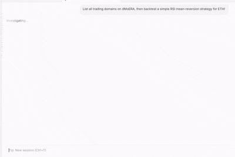

# dMoERA Creator Studio — MCP Server

[](https://lightnow.ai/servers/io.github.CacheCarti/dmoera-creator)



Build, backtest, and deploy crypto trading strategies using any MCP-compatible AI agent (Claude, Cursor, Windsurf, Devin, Copilot, etc.).

## What it does

The dMoERA MCP server exposes the [dMoERA](https://dmoera.xyz) Creator API as Model Context Protocol tools. Your AI agent can:

- **Discover** trading domains, data feeds, and market regimes
- **Inspect** existing bots and their live performance metrics
- **Backtest** strategy code in a sandboxed environment
- **Submit** strategies for full 7-stage validation and live deployment
- **Manage personal hedge funds** — create funds, add your own bots, activate Manager Mode
- **Monitor** tournament status, Tag Team leaderboards, and Vault allocation
- **Track** fund positions, trades, P&L, analytics, and immutable report cards

This is a thin API client — it talks to a running dMoERA backend via HTTP. No internal dMoERA code is required.

## Installation

### Prerequisites

- Python 3.11+
- The `mcp` Python package (`pip install mcp`)
- A running dMoERA backend (or connect to the public instance)

### Setup

```bash
git clone https://github.com/CacheCarti/dmoera-mcp.git
cd dmoera-mcp
pip install -r requirements.txt
```

## MCP Configuration

Add this standard MCP configuration to Claude Desktop, Cursor, Windsurf, or another MCP client:

```json
{
  "mcpServers": {
    "dmoera-creator": {
      "command": "python",
      "args": ["/absolute/path/to/dmoera-mcp/mcp_creator_server.py"],
      "env": {
        "DMOERA_API_URL": "https://dmoera.xyz",
        "DMOERA_API_KEY": "your_optional_personal_access_token"
      }
    }
  }
}
```

The API key is optional for public market data and discovery tools. Create a Personal Access Token at [dmoera.xyz](https://dmoera.xyz) under **Settings → API Keys** to backtest, submit, fork, open-source, or delist strategies. Never commit your token.

Remote clients can connect through the Streamable HTTP endpoint:

```text
https://dmoera.xyz/mcp
```

## Tools (44 total)

### Discovery & Market Data

| Tool | Description | Auth Required |
|------|-------------|---------------|
| [list_domains](cci:1://file:///c:/Users/yoges/dmoen-core/mcp_creator_server.py:95:0-118:40) | List all available trading domains (ETH, BTC, SOL — spot and scalp) | No |
| [list_bots](cci:1://file:///c:/Users/yoges/dmoen-core/mcp_creator_server.py:121:0-154:54) | List trading bots ranked by performance, optionally filtered by domain | No |
| [get_bot_profile](cci:1://file:///c:/Users/yoges/dmoen-core/mcp_creator_server.py:157:0-176:54) | Get detailed profile and performance stats for a specific bot | No |
| [get_feature_catalog](cci:1://file:///c:/Users/yoges/dmoen-core/mcp_creator_server.py:179:0-205:41) | List all data feeds available to strategies via `ctx.features` | No |
| [get_market_regime](cci:1://file:///c:/Users/yoges/dmoen-core/mcp_creator_server.py:210:0-229:54) | Get current market regime classification | No |
| [get_current_prices](cci:1://file:///c:/Users/yoges/dmoen-core/mcp_creator_server.py:232:0-243:54) | Get current live prices for all tracked symbols | No |

### Strategy Development

| Tool | Description | Auth Required |
|------|-------------|---------------|
| [sandbox_backtest](cci:1://file:///c:/Users/yoges/dmoen-core/mcp_creator_server.py:248:0-281:54) | Backtest strategy code in a sandboxed environment | Yes |
| [submit_strategy](cci:1://file:///c:/Users/yoges/dmoen-core/mcp_creator_server.py:284:0-325:54) | Submit a strategy for full validation and live deployment | Yes |
| [list_strategies](cci:1://file:///c:/Users/yoges/dmoen-core/mcp_creator_server.py:328:0-342:54) | List all strategies created by a user | Yes |
| [get_strategy_report](cci:1://file:///c:/Users/yoges/dmoen-core/mcp_creator_server.py:345:0-363:54) | Get a detailed report card for a strategy | No |

### Marketplace & Tournaments

| Tool | Description | Auth Required |
|------|-------------|---------------|
| [get_marketplace_bots](cci:1://file:///c:/Users/yoges/dmoen-core/mcp_creator_server.py:368:0-388:54) | List bots published to the marketplace | No |
| [get_tournament_status](cci:1://file:///c:/Users/yoges/dmoen-core/mcp_creator_server.py:393:0-408:54) | Get current tournament round status and leaderboard | No |

### Fund Management (personal funds — own bots only)

Personal funds can **only** contain the authenticated user's own bots. Use [list_my_bots](cci:1://file:///c:/Users/yoges/dmoen-core/mcp_creator_server.py:739:0-759:54) to see eligible strategies.

| Tool | Description | Auth Required |
|------|-------------|---------------|
| [list_funds](cci:1://file:///c:/Users/yoges/dmoen-core/mcp_creator_server.py:415:0-427:54) | List your funds (active + closed) | Yes |
| [get_fund](cci:1://file:///c:/Users/yoges/dmoen-core/mcp_creator_server.py:430:0-444:54) | Fund details including roster | Yes |
| [get_active_fund](cci:1://file:///c:/Users/yoges/dmoen-core/mcp_creator_server.py:447:0-457:54) | Currently active Manager Mode fund | Yes |
| [create_fund](cci:1://file:///c:/Users/yoges/dmoen-core/mcp_creator_server.py:460:0-493:54) | Create a personal hedge fund | Yes |
| [add_bot_to_fund](cci:1://file:///c:/Users/yoges/dmoen-core/mcp_creator_server.py:496:0-519:54) | Add your own bot to a fund's roster | Yes |
| [remove_bot_from_fund](cci:1://file:///c:/Users/yoges/dmoen-core/mcp_creator_server.py:522:0-540:54) | Remove a bot from the roster | Yes |
| [swap_bot_in_fund](cci:1://file:///c:/Users/yoges/dmoen-core/mcp_creator_server.py:543:0-579:54) | Swap one bot for another (friction cost applies) | Yes |
| [update_fund_weights](cci:1://file:///c:/Users/yoges/dmoen-core/mcp_creator_server.py:582:0-597:54) | Update allocation weights for roster bots | Yes |
| [update_fund_caps](cci:1://file:///c:/Users/yoges/dmoen-core/mcp_creator_server.py:600:0-630:54) | Update risk caps (max per bot, per domain, regime veto) | Yes |
| [activate_fund](cci:1://file:///c:/Users/yoges/dmoen-core/mcp_creator_server.py:633:0-650:54) | Activate Manager Mode — starts the personal router | Yes |
| [deactivate_fund](cci:1://file:///c:/Users/yoges/dmoen-core/mcp_creator_server.py:653:0-668:54) | Deactivate Manager Mode — return to main router | Yes |
| [close_fund](cci:1://file:///c:/Users/yoges/dmoen-core/mcp_creator_server.py:671:0-687:54) | Permanently close a fund (capital returned to wallet) | Yes |
| [estimate_swap_cost](cci:1://file:///c:/Users/yoges/dmoen-core/mcp_creator_server.py:690:0-713:54) | Estimate friction cost (bps) before swapping bots | Yes |
| [list_my_bots](cci:1://file:///c:/Users/yoges/dmoen-core/mcp_creator_server.py:739:0-759:54) | Your own bots eligible for a personal fund roster | Yes |
| [list_open_source_bots](cci:1://file:///c:/Users/yoges/dmoen-core/mcp_creator_server.py:716:0-736:54) | Browse the broader open-source bot ecosystem | No |
| [get_fund_positions](cci:1://file:///c:/Users/yoges/dmoen-core/mcp_creator_server.py:762:0-775:54) | Open positions for a fund's roster bots | Yes |
| [get_fund_trades](cci:1://file:///c:/Users/yoges/dmoen-core/mcp_creator_server.py:778:0-795:54) | Closed trade history for a fund's roster bots | Yes |
| [get_fund_performance](cci:1://file:///c:/Users/yoges/dmoen-core/mcp_creator_server.py:798:0-812:54) | P&L time-series snapshots for a fund | Yes |
| [get_fund_live_pnl](cci:1://file:///c:/Users/yoges/dmoen-core/mcp_creator_server.py:815:0-828:54) | Real-time cumulative PnL chart from closed positions | Yes |
| [get_fund_analytics](cci:1://file:///c:/Users/yoges/dmoen-core/mcp_creator_server.py:831:0-845:54) | Dashboard analytics: allocation, per-bot performance, risk | Yes |
| [run_fund_historical_test](cci:1://file:///c:/Users/yoges/dmoen-core/mcp_creator_server.py:848:0-869:54) | Simulate a roster against historical data (rate limited) | Yes |
| [generate_fund_report_card](cci:1://file:///c:/Users/yoges/dmoen-core/mcp_creator_server.py:872:0-885:54) | Generate an immutable report card for a fund | Yes |
| [get_fund_report_card](cci:1://file:///c:/Users/yoges/dmoen-core/mcp_creator_server.py:888:0-901:54) | Get the latest report card for a fund | Yes |

### Tag Team (daily paper trading competition)

| Tool | Description | Auth Required |
|------|-------------|---------------|
| [tag_team_info](cci:1://file:///c:/Users/yoges/dmoen-core/mcp_creator_server.py:906:0-921:54) | Session info, open positions, bot status, rank | Yes |
| [tag_team_templates](cci:1://file:///c:/Users/yoges/dmoen-core/mcp_creator_server.py:924:0-936:54) | Co-Pilot templates (momentum, scalper, etc.) | No |
| [tag_team_leaderboard](cci:1://file:///c:/Users/yoges/dmoen-core/mcp_creator_server.py:939:0-956:54) | Daily leaderboard (optional date filter) | Yes |
| [tag_team_weekly](cci:1://file:///c:/Users/yoges/dmoen-core/app_v4.py:12016:0-12025:52) | Weekly championship standings | Yes |
| [tag_team_history](cci:1://file:///c:/Users/yoges/dmoen-core/mcp_creator_server.py:969:0-976:54) | Past sessions with scores | Yes |
| [tag_team_tier](cci:1://file:///c:/Users/yoges/dmoen-core/mcp_creator_server.py:979:0-991:54) | Tier progression (Rookie → Master) | Yes |
| [tag_team_badges](cci:1://file:///c:/Users/yoges/dmoen-core/mcp_creator_server.py:994:0-1005:54) | Earned badges (Daily Champion, Bot Whisperer, etc.) | Yes |

### Vault (regime-aware allocation)

| Tool | Description | Auth Required |
|------|-------------|---------------|
| [get_vault_status](cci:1://file:///c:/Users/yoges/dmoen-core/mcp_creator_server.py:1010:0-1023:54) | Current regime, allocation weights, sleeve holdings | Yes |
| [get_vault_history](cci:1://file:///c:/Users/yoges/dmoen-core/mcp_creator_server.py:1026:0-1036:54) | Regime switch timeline | Yes |

## Resources

- `creator-api://docs` — Full strategy contract documentation
- `creator-api://strategy-template` — Copy-pasteable strategy template

## Example Usage

Ask your AI agent:

> "List all trading domains on dMoERA, then backtest a simple RSI mean-reversion strategy for ETH/USDC."

The agent will call [list_domains](cci:1://file:///c:/Users/yoges/dmoen-core/mcp_creator_server.py:95:0-118:40), inspect the available markets, then call [sandbox_backtest](cci:1://file:///c:/Users/yoges/dmoen-core/mcp_creator_server.py:248:0-281:54) with strategy code it generates. You can iterate:

> "The Sharpe is too low. Try adding a volatility filter — only trade when ATR is above its 20-period average."

> "Submit this strategy to the ETH/USDC domain."

The agent calls [submit_strategy](cci:1://file:///c:/Users/yoges/dmoen-core/mcp_creator_server.py:284:0-325:54), which runs the full 7-stage validation pipeline. If it passes, the strategy enters the live Arena and competes for tournament payouts.

### Hedge Fund Management

> "Create a personal hedge fund called 'Alpha Seeker' with a standard risk preset. Then list my eligible bots."

The agent calls [create_fund](cci:1://file:///c:/Users/yoges/dmoen-core/mcp_creator_server.py:460:0-493:54), then [list_my_bots](cci:1://file:///c:/Users/yoges/dmoen-core/mcp_creator_server.py:739:0-759:54) to show which of your strategies can be added to the roster.

> "Add my momentum ETH bot with 30% weight and my scalper BTC bot with 20% weight, then activate the fund."

The agent calls [add_bot_to_fund](cci:1://file:///c:/Users/yoges/dmoen-core/mcp_creator_server.py:496:0-519:54) twice, [update_fund_weights](cci:1://file:///c:/Users/yoges/dmoen-core/mcp_creator_server.py:582:0-597:54), then [activate_fund](cci:1://file:///c:/Users/yoges/dmoen-core/mcp_creator_server.py:633:0-650:54) to start the personal router.

> "How's the fund doing? Show me the analytics and latest report card."

The agent calls [get_fund_analytics](cci:1://file:///c:/Users/yoges/dmoen-core/mcp_creator_server.py:831:0-845:54) and [get_fund_report_card](cci:1://file:///c:/Users/yoges/dmoen-core/mcp_creator_server.py:888:0-901:54).

## Strategy Contract

Strategies subclass `Strategy` and implement `on_bar(self, ctx) -> Signal`. See the `creator-api://docs` resource for the full contract.

```python
class MyStrategy(Strategy):
    METADATA = {
        "name": "SMA Crossover",
        "domain": "eth_usdc",
        "declared_sl_bps": 150.0,
        "declared_tp_bps": 300.0,
        "declared_hold_seconds": 3600,
        "warmup_bars": 20,
        "required_features": [],
    }

    def on_bar(self, ctx):
        closes = ctx.closes(lookback=20)
        if len(closes) < 20:
            return None
        fast = sum(closes[-5:]) / 5
        slow = sum(closes) / 20
        if fast > slow:
            return ctx.signal(
                direction=SignalDirection.LONG,
                confidence=0.7,
                stop_loss_bps=150.0,
                take_profit_bps=300.0,
                horizon_seconds=3600,
            )
        return None
```

## Hedge Fund System

Personal hedge funds (Manager Mode) let you build a portfolio of **your own bots**:

1. Create a fund with a risk preset (prudent, standard, opportunistic, unrestricted)
2. Add your own bots to the roster with allocation weights
3. Set risk caps — max allocation per bot, per domain, regime veto
4. Activate Manager Mode to deploy capital across the roster
5. Monitor PnL, swap bots as needed, adjust weights
6. Generate immutable report cards for track record
7. Close the fund to return all capital to your wallet

The personal router replaces the main platform router while Manager Mode is active, giving you full control over which bots trade and how much capital they get. Personal funds can **never** contain another user's bots.

## Tag Team System

Tag Team is a standalone daily paper-trading competition, separate from the main router and tournaments:

- **Start**: Pick a Co-Pilot template (momentum, scalper, etc.) → get $10,000 paper capital
- **Capital split**: 70% human ($7,000), 30% Co-Pilot bot ($3,000)
- **Manual trades**: 20 max per day, leverage 1-20x
- **Bot deploy**: After 3 closed manual trades, deploy the Co-Pilot
- **Scoring**: Need 5+ human trades AND 5+ bot trades to qualify
- **End**: At UTC midnight, all open positions close at market price
- **Next day**: Fresh $10k, but bot params carry over (trained settings persist)

Tiers: Rookie (0) → Apprentice (10) → Trader (50) → Veteran (150) → Expert (500) → Master (1000+), based on total trades across all sessions.

## Tournament System

Bots compete in 3-day tournament rounds. Scoring is based on the bot's own performance:
- **50%** risk-adjusted (rolling Sharpe ratio)
- **30%** total return (log-scaled bps)
- **20%** consistency (win rate × trade volume)

Top 3 per domain win USDT from the reward pool. **No user following needed to qualify** — your bot competes on its own metrics.

## Links

- **Platform**: [dmoera.xyz](https://dmoera.xyz)
- **GitHub**: [github.com/CacheCarti/dmoera-mcp](https://github.com/CacheCarti/dmoera-mcp)
- **Twitter**: [@dMoERAHQ](https://x.com/dMoERAHQ)
- **Discord**: [discord.gg/gXWDjDdQv](https://discord.gg/gXWDjDdQv)

## License

MIT
